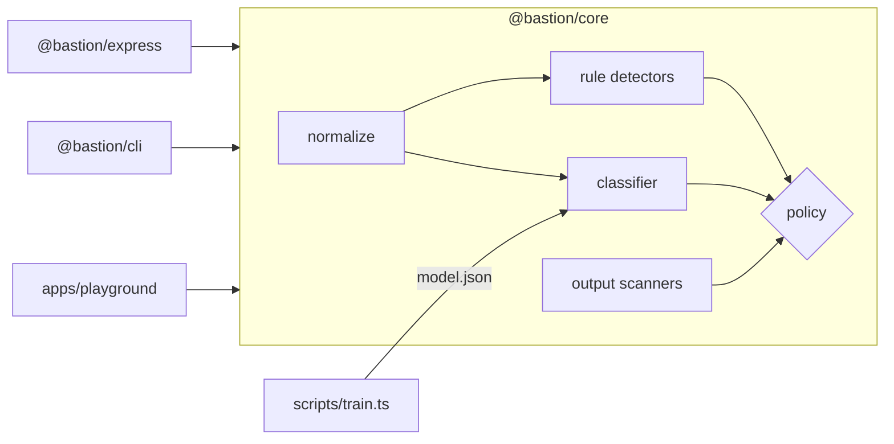

# Architecture

Bastion is a library first. `@bastion/core` holds every decision and has no runtime dependencies, so the same code runs in the Express middleware, the CLI and the browser playground. The adapters only translate between their environment and two calls: `inspectInput(text, context)` and `inspectOutput(text, context)`.



## Modules

```text
packages/core/src/
  normalize/     invisible.ts, confusables.ts, leet.ts, fold.ts, skeleton.ts, decoders.ts, english.ts, normalize.ts
  detectors/     pattern-detector.ts, rules/*.ts (five rule sets), obfuscation.ts, heuristics.ts, score.ts
  classifier/    features.ts, logistic.ts, model.ts, classifier.ts, default-model.ts, model.json
  output/        pii.ts, luhn.ts, secrets.ts, entropy.ts, canary.ts, leak.ts, redact.ts, scan-output.ts
  policy/        types.ts (defaults), validate.ts, resolve.ts
  eval/          metrics.ts, split.ts
  firewall.ts    createFirewall: the only place the pieces are combined
packages/express/src/   extract.ts, options.ts, middleware.ts
packages/cli/src/       args.ts, io.ts, format.ts, data.ts, commands/{scan,redact,eval}.ts
apps/playground/src/    report.ts (pure view model), render.ts, dom.ts, samples.ts, main.ts
scripts/                fetch-datasets.ts, train.ts, evaluate.ts, bench.ts, check-pages-build.mjs
```

Dependencies point one way. `normalize` knows nothing about detectors, detectors and the classifier both consume a `NormalizedInput`, `output` is independent of the input side, and `firewall.ts` is the only module that imports all of them. `eval` is in core because the CLI's `eval` command and `scripts/evaluate.ts` must compute metrics the same way.

## Inspecting a prompt

`inspectInput` runs these steps synchronously and allocates nothing that outlives the call.

1. **Resolve the policy.** `resolvePolicy` picks the most specific route match (exact path, then the glob with the longest literal prefix) and deep-merges it over the defaults. The configuration was validated once in `createFirewall`, so a typo in a route fails at startup, not on the first request.
2. **Normalize.** `normalize` truncates at `maxLength`, builds the primary view (NFC, invisible code points removed) and runs the decoders on it. Each decoded payload that is valid, mostly printable text becomes a new view and is itself decoded, breadth-first, up to depth 3 and 16 views. Every view gets a skeleton: NFKC, confusables mapped to Latin, lowercased, combining marks stripped, leetspeak decoded inside words, spaced letters joined. The result also carries evasion signals (what was removed or decoded, and how much). See [ADR 0001](adr/0001-normalize-into-views-before-detecting.md).
3. **Run the rules.** Each of the five pattern detectors matches its weighted rules against every view's skeleton and returns the noisy-OR of the matched weights with evidence (rule, matched text, view). The obfuscation detector turns the evasion signals into a score and raises it when a rule matched only inside a decoded view. `runHeuristics` combines the detectors with noisy-OR again, so two independent medium signals outrank one.
4. **Run the classifier.** If the policy enables it, every view's skeleton is hashed into a sparse vector and scored. The highest logit wins, because an attacker controls which view carries the payload. The logit is shifted by `logit(threshold)` so the threshold picked on validation data sits at 0.5, and the 24 terms with the largest contribution are returned for explanation. See [ADR 0002](adr/0002-hashed-ngram-logistic-regression-from-scratch.md).
5. **Decide.** `score = max(rules, classifier)`, compared with `flagAt` and `blockAt`. See [ADR 0003](adr/0003-calibrated-max-score-combination.md).

The decision keeps both component scores, the findings, the signals, the view sources and the contributions. The CLI, the playground and the 403 body all render from that one object.

## Inspecting a response

`inspectOutput` scans the text once per scanner, then applies policy.

- **Folding with an offset map.** `foldWithMap` removes invisible characters and applies NFKC per code point while recording, for every output index, where it came from in the original. Patterns run on the folded text and spans are mapped back, so `lan​@example.vn` with a zero-width space is found, and the redaction covers the original characters including the hidden one.
- **PII** is pattern plus validation: Luhn and issuer prefixes for cards, the allocated mobile prefixes and the `02` landline prefix and length for Vietnamese numbers, province codes for citizen IDs. A validator that fails drops the match instead of lowering its confidence.
- **Secrets** are tried most-specific first (vendor key formats before generic assignments before entropy), and overlapping matches keep the most specific rule.
- **Canaries** are searched for in several renderings: exact, case- and Unicode-folded, with separators removed, reversed, and inside base64 runs. The token is random and never appears in normal text, so any hit is high confidence.
- **Prompt leakage** without a canary uses word 6-gram shingles of the system prompt. A response leaks when it covers a quarter of the shingles or repeats three of them.

Each finding gets the action the route's policy assigns to its type. The strongest action wins (`block` > `redact` > `flag` > `allow`), and when the result is `redact`, the spans are replaced right to left so earlier offsets stay valid.

## Express middleware

`bastion()` installs the input and output handlers. The input handler extracts user text from the body, inspects each piece, and answers 403 on `block` before the route runs. The output handler replaces `res.json` and `res.send` on the response object: the body is inspected when the route sends it, then the original method is called with the original or redacted body, or the response becomes a 502. A `busy` flag stops the wrapper from inspecting its own error body. If inspection throws, the handler answers 503 unless `failMode: 'open'` ([ADR 0004](adr/0004-fail-closed-middleware.md)).

## Training and evaluation

```text
fetch-datasets.ts  -> .cache/downloads/*.jsonl + manifest (revision, license, SHA-256)
train.ts           -> split (seed 1337) -> grid search on validation -> fit -> model.json
evaluate.ts        -> test split -> eval/results.json, docs/EVALUATION.md, docs/assets/roc.svg
bench.ts           -> docs/BENCHMARKS.md
```

The split is computed in `core/eval/split.ts`: rows that are identical after normalization are de-duplicated, texts that appear with both labels are dropped, and the rest is stratified by dataset and label into 20% test, then 15% of the remainder for validation. Training and evaluation call the same function with the same seed, so the test split is never seen by the trainer. The evaluation script writes the Markdown report from `results.json`; nothing in `docs/EVALUATION.md` is typed by hand.

## Playground

`report.ts` turns a decision into a view model (every detector, fired or not, its explanation, the evidence spans to highlight, the classifier terms) and is unit tested without a DOM. `render.ts` writes it into the page with `textContent` only. The page is built with Vite under `/bastion-llm-firewall/` and carries a CSP with `connect-src 'none'`. `scripts/check-pages-build.mjs` runs in CI after the build and fails if the base path is wrong, the CSP is missing, or the bundle references `fetch`, `XMLHttpRequest`, `WebSocket`, `EventSource` or `sendBeacon`.

## Explaining it in five minutes

- The problem is that a model cannot tell instructions from data. Bastion does not fix that; it lowers the rate of the cheap attacks and the cost of the obvious leaks, and is honest about the rest (README, Limitations).
- Attackers hide text, so the work starts with Unicode: the same string is inspected in several decoded forms, and both the rules and the classifier see a canonical skeleton. Without it, a zero-width space defeats any keyword rule.
- Two scorers with different failure modes: hand-written rules (precise, explainable, low recall) and a small learned model (recall, generalization). They are combined by `max` after calibrating the classifier, and the evaluation reports each alone and together on a held-out split.
