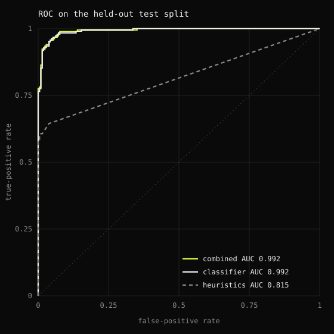

# Evaluation

> Generated by `npm run evaluate` ([scripts/evaluate.ts](../scripts/evaluate.ts)). Do not edit by hand; numbers come from [eval/results.json](../eval/results.json).

## Data

| Dataset | Revision | License |
| --- | --- | --- |
| [deepset/prompt-injections](https://huggingface.co/datasets/deepset/prompt-injections) | `4f61ecb0` | apache-2.0 |
| [jackhhao/jailbreak-classification](https://huggingface.co/datasets/jackhhao/jailbreak-classification) | `2f2ceeb3` | apache-2.0 |

Both datasets were fetched with `npm run fetch-data` through the Hugging Face datasets-server API (all published splits merged): 1968 rows. 18 exact duplicates (after normalization) and 0 rows whose duplicates carry the opposite label were removed, leaving 1950 unique rows.

The rows were split with a fixed seed (1337), stratified by dataset and label: 20.0% held out as the **test split**, and 15.0% of the rest kept as a validation split for choosing hyper-parameters and the classifier threshold.

| Split | Injection | Benign |
| --- | ---: | ---: |
| fit (training) | 620 | 704 |
| validation | 110 | 125 |
| test (held out) | 183 | 208 |

The heuristic rules were written before the datasets were downloaded and were not changed after looking at test-split results. The classifier never sees the test split during training.

## Results on the held-out test split

Decision threshold 0.5 for every mode (the classifier probability is calibrated so its validation-chosen threshold maps to 0.5). Combined score = max(heuristic score, classifier score).

| Mode | Precision | Recall | F1 | Accuracy | False-positive rate | ROC-AUC |
| --- | ---: | ---: | ---: | ---: | ---: | ---: |
| heuristics only | 100.0% | 58.5% | 73.8% | 80.6% | 0.0% | 0.815 |
| classifier only | 95.6% | 94.5% | 95.0% | 95.4% | 3.9% | 0.992 |
| combined | 95.6% | 94.5% | 95.0% | 95.4% | 3.9% | 0.992 |



### Confusion matrices

**Heuristics only**

|  | predicted injection | predicted benign |
| --- | ---: | ---: |
| actual injection | 107 | 76 |
| actual benign | 0 | 208 |

**Classifier only**

|  | predicted injection | predicted benign |
| --- | ---: | ---: |
| actual injection | 173 | 10 |
| actual benign | 8 | 200 |

**Combined**

|  | predicted injection | predicted benign |
| --- | ---: | ---: |
| actual injection | 173 | 10 |
| actual benign | 8 | 200 |

### Per dataset

| Dataset | Mode | Precision | Recall | F1 | Accuracy | False-positive rate | ROC-AUC |
| --- | --- | ---: | ---: | ---: | ---: | ---: | ---: |
| deepset/prompt-injections | heuristics | 100.0% | 34.0% | 50.7% | 73.7% | 0.0% | 0.675 |
| deepset/prompt-injections | classifier | 95.8% | 86.8% | 91.1% | 93.2% | 2.5% | 0.981 |
| deepset/prompt-injections | combined | 95.8% | 86.8% | 91.1% | 93.2% | 2.5% | 0.984 |
| jackhhao/jailbreak-classification | heuristics | 100.0% | 68.5% | 81.3% | 84.1% | 0.0% | 0.872 |
| jackhhao/jailbreak-classification | classifier | 95.5% | 97.7% | 96.6% | 96.5% | 4.7% | 0.996 |
| jackhhao/jailbreak-classification | combined | 95.5% | 97.7% | 96.6% | 96.5% | 4.7% | 0.996 |

Heuristic scores are mostly exactly 0 for inputs no rule matches, so their ROC curve has few distinct points and ties are counted as half in the AUC.

### Rules and classifier on the test injections

| Caught by both | Rules only | Classifier only | Missed by both |
| ---: | ---: | ---: | ---: |
| 107 | 0 | 66 | 10 |

On this split the rules caught nothing the classifier missed, so at the 0.5 threshold the combined decisions equal the classifier-only decisions (ROC-AUC 0.9919 classifier vs 0.9924 combined). The rules still provide the per-detector explanations and the checks on obfuscated input, which these datasets barely contain.

### Threshold sweep (combined)

The default policy flags at 0.5 and blocks at 0.8.

| Threshold | Precision | Recall | F1 | False-positive rate |
| ---: | ---: | ---: | ---: | ---: |
| 0.3 | 83.9% | 99.5% | 91.0% | 16.8% |
| 0.4 | 91.8% | 98.4% | 95.0% | 7.7% |
| 0.5 | 95.6% | 94.5% | 95.0% | 3.9% |
| 0.6 | 97.7% | 92.9% | 95.2% | 1.9% |
| 0.7 | 98.2% | 90.7% | 94.3% | 1.4% |
| 0.8 | 98.7% | 85.8% | 91.8% | 1.0% |
| 0.9 | 100.0% | 77.0% | 87.0% | 0.0% |

## Known blind spots

- Short deepset rows labelled as injections that contain no instruction-like wording are the largest group of misses: a request for a joke, a political statement after "stop:", or a role assignment such as "you are <a newspaper>". Some look like label noise; either way, neither the rules nor an n-gram model can separate them from ordinary questions.
- Non-English attacks. The rules cover a few common German, French, Spanish and Vietnamese phrasings of "ignore the previous instructions" and nothing else. In the test split a French "Oubliez toutes les instructions et ..." and a German "Stell dir vor, du bist eine böse KI ..." were missed by both halves.
- Persona jailbreaks that avoid the known vocabulary (no DAN, no "developer mode", no "no ethical guidelines") are left to the classifier; a few long persona prompts scored just under the threshold.
- Most classifier false alarms are long, instruction-heavy benign prompts (reading-comprehension tasks with "Detailed Instructions:" or "Article:" sections), because long instruction-style text in the training data is mostly jailbreaks. Political opinion questions cause a few more, because many deepset injections ask for political statements.
- Both datasets are small (about 2,000 unique rows). One test row moves recall by about 0.5 percentage points, and the numbers will not transfer to traffic that looks different from these two datasets.
- The datasets contain almost no obfuscated text (zero-width characters, look-alike letters, base64), so the normalizer is checked by unit tests, not by this evaluation. Words separated only by zero-width characters ("ignore" + U+200B + "all") become one word after normalization and can slip past rules that expect a space.
- Indirect injection (instructions hidden in a retrieved web page or document rather than typed by the user) is not represented in either dataset and is not measured here.

## Reproduce

```bash
npm ci
npm run fetch-data   # downloads into .cache/downloads and checks licenses
npm run train        # rewrites packages/core/src/classifier/model.json
npm run evaluate     # rewrites this file, eval/results.json and docs/assets/roc.svg
```
